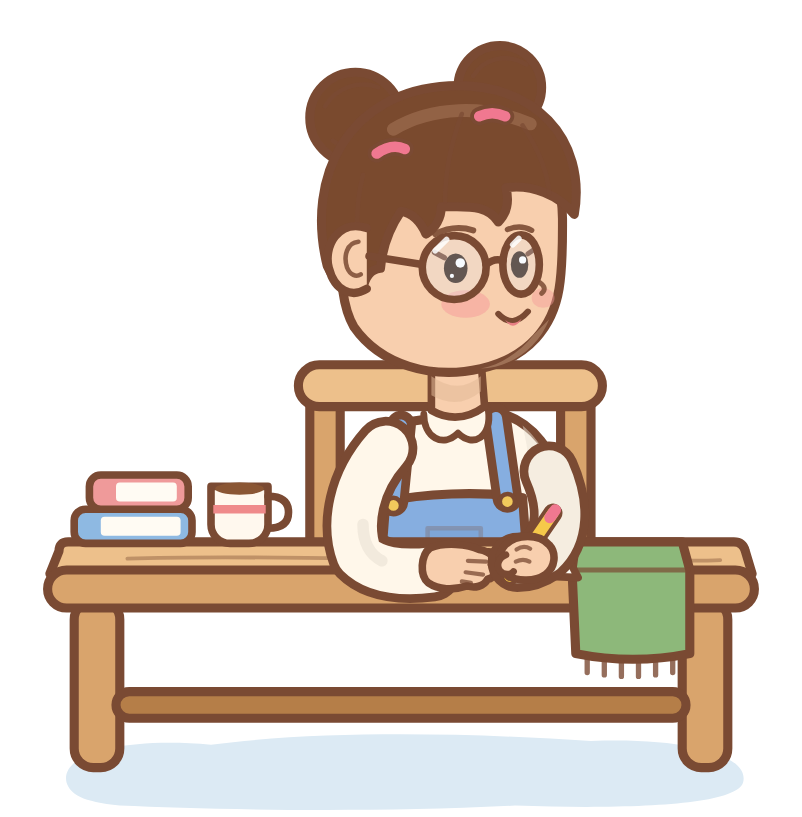

# Çalışma Arkadaşım

Ekranın kenarında, ders masasının başında tableti ve kalemiyle seninle birlikte çalışan küçük bir karakter. Sen odaklandıkça XP kazanır, seviye atlar, yeni eşyalar ve özellikler açılır.

> 🔒 Kaynak kod şimdilik kapalı. Bu depo projeyi tanıtmak için var.

## Nasıl çalışır

- **Odak seansı:** her dakika 1 XP, seansı bitirmek +5 XP, görev bitirmek +3 XP
- **Uzaklaşınca durur:** bilgisayardan uzaklaşınca saat durur ve karakter uyur, dönünce kaldığı yerden devam eder
- **Her seansta bir çizim:** karakter tabletine bir resim çizer, resim seansla birlikte ilerler
- **Ekranda serbest:** sürükleyip istediğin yere koyabilirsin, kenara yaklaşınca kenara yapışır
- Karaktere tıklayınca panel açılır, sağ tıkla kısa menü, tepside simgesi durur

## Seviyeyle açılanlar

| Seviye | Açılan |
|---|---|
| 2 | Motive eden konuşmalar, topuz saç |
| 3 | Su ve mola hatırlatıcıları, gözlük |
| 4 | Kulaklık, renkli tabletler |
| 5 | Görev listesi |
| 6 | Kedi arkadaş |
| 8 | Çizim galerisi |
| 10 | Taç, parıltı |
| 12 | Kuş arkadaş |

## Teknik

- Electron ile iki şeffaf pencere: karakter ve panel. Durumun tek sahibi ana süreç, pencereler her saniye kopyasını alır.
- Karakter tamamen kodla çizilen SVG: katmanlı çizim (saç ve gövde, masa ve eşyalar, kollar), ruh hâline göre değişen animasyonlar (yazma, kupadan içme, uyuma)
- Kayıt dosyası önce geçici dosyaya yazılıp sonra yerine konur, böylece yarım kayıt oluşmaz
- Her kıyafet, aksesuar ve çizimin tek sayfada görüldüğü bir tasarım kataloğu

---

Geliştiren: [Halit Bulut](https://github.com/HalittBulut)
